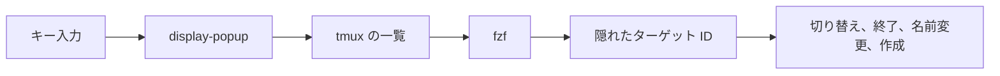

<div align="center">

# tmux-fzf-revamped

<strong>ポップアップ内の fzf ピッカーから、tmux のセッション、ウィンドウ、ペインの切り替え、終了、名前変更、作成を行います。</strong>

[English](README.md) &nbsp;|&nbsp; 日本語 &nbsp;|&nbsp; [简体中文](README.zh-Hans.md) &nbsp;|&nbsp; [繁體中文（香港）](README.zh-HK.md)

[](https://github.com/tmux-revamped/tmux-fzf-revamped/actions/workflows/tests.yml)
[](LICENSE)
[](CHANGELOG.md)

<p align="center">
  <a href="#できること">できること</a> &nbsp;|&nbsp;
  <a href="#動作要件">動作要件</a> &nbsp;|&nbsp;
  <a href="#インストール">インストール</a> &nbsp;|&nbsp;
  <a href="#使い方">使い方</a> &nbsp;|&nbsp;
  <a href="#設定">設定</a> &nbsp;|&nbsp;
  <a href="#キーバインド">キーバインド</a> &nbsp;|&nbsp;
  <a href="#仕組み">仕組み</a> &nbsp;|&nbsp;
  <a href="#開発">開発</a>
</p>

</div>

アクションは **16** 個、デフォルトで割り当て済みのキーは **1** 個、パレットに入っている tmux コマンドは **10** 個です。

---

## できること

各アクションは tmux のポップアップで fzf のリストを開きます。項目を選ぶとプラグインがそれに対して動作します。セッション、ウィンドウ、ペインへの切り替え、終了、名前変更、まだ存在しないセッションの作成ができます。

| アクション | 動作 |
|:-------|:-------------|
| palette | 10 個の tmux コマンドのいずれかを実行します：`new-window`、2 種類の分割、次・前・直前のウィンドウ、`kill-pane`、`kill-window`、`detach-client`、`choose-tree` |
| session switch | セッションをウィンドウ数とともに一覧表示し、クライアントを切り替えます |
| window switch | すべてのセッションのすべてのウィンドウを一覧表示し、選んだものを選択します |
| pane switch | すべてのペインを実行中のコマンドとともに一覧表示し、選んだものを選択します |
| session kill | 選んだセッションを確認なしで終了します |
| tree | セッション、ウィンドウ、ペインを 1 つのリストにまとめ、選んだものへ移動します |
| create | 選んだセッションへ切り替えます。一致するものがなければ、クエリの名前でセッションを作成して切り替えます |
| URLs | 現在のペインの表示画面にある URL を一覧表示し、選んだものを `open` または `xdg-open` で開きます |
| cheatsheet | `list-keys` の出力を検索します |
| process | `ps` のプロセスを一覧表示し、`no` か `yes` を確認してから、選んだプロセスに `TERM` を送ります |
| rename | ウィンドウを選んでから、新しい名前の入力を求めます |
| multi-kill | `Tab` で複数のセッションに印を付け、`no` か `yes` を確認してから、すべて終了します |
| broadcast | 1 行のテキストの入力を求め、複数のペインに印を付けてから、各ペインにそのテキストを入力して `Enter` を送ります |
| zoxide | `zoxide query -l` のディレクトリを一覧表示し、選んだディレクトリでセッションにアタッチするか、新しく作成します |
| last | ピッカーを使わずに、クライアントを直前のセッションへ切り替えます |
| move | ウィンドウを選んでから、移動先のセッションの入力を求めます |

クエリやディレクトリから作るセッション名には、パスの最後の要素だけが使われ、`.`、`:`、空白は `_` に置き換えられます。

## 動作要件

| 要件 | バージョンまたは補足 |
|:------------|:----------------|
| tmux | ポップアップには 3.2 以降が必要です。それより古い tmux では各ピッカーが新しいウィンドウで開きます |
| bash | 3.2 以降。macOS の `/bin/bash` で動作します |
| [fzf](https://github.com/junegunn/fzf) | `PATH` 上にあること |
| [zoxide](https://github.com/ajeetdsouza/zoxide)、任意 | zoxide アクションに使います |
| オープナー、任意 | URL アクションに `open` または `xdg-open` を使います |

CI は、Linux x86_64 と arm64 で GNU coreutils と uutils coreutils を使って、また macOS の Apple Silicon と Intel でシステムの BSD ツール、GNU coreutils、uutils coreutils を使って、テストスイートを実行します。

## インストール

[TPM](https://github.com/tmux-plugins/tpm) を使う場合は、`~/.tmux.conf` にプラグインを追加して `prefix + I` を押します。

```tmux
set -g @plugin 'tmux-revamped/tmux-fzf-revamped'
```

TPM を使わない場合は、リポジトリをクローンし、`~/.tmux.conf` からエントリポイントを実行します。

```sh
git clone https://github.com/tmux-revamped/tmux-fzf-revamped ~/.tmux/plugins/tmux-fzf-revamped
```

```tmux
run-shell ~/.tmux/plugins/tmux-fzf-revamped/fzf-revamped.tmux
```

## 使い方

`prefix + M-f` でコマンドパレットが開きます。ほかのアクションは、キーを割り当てるまで未割り当てのままです。次の例では、標準の `s` と `w` のチューザーを fzf ピッカーに置き換え、いくつかのアクションを追加します。

```tmux
set -g @fzf_revamped_session_key s
set -g @fzf_revamped_window_key w
set -g @fzf_revamped_pane_key e
set -g @fzf_revamped_tree_key T
set -g @fzf_revamped_create_key C
set -g @fzf_revamped_last_key L
```

どのピッカーでも、入力で絞り込み、`Enter` で実行し、`Esc` で何もせずに閉じます。`@fzf_revamped_preview` を `on` にすると、切り替えピッカーのリストの下に、カーソル位置の項目の画面が表示されます。

## 設定

| オプション | デフォルト | 意味 |
|:-------|:--------|:--------|
| `@fzf_revamped_popup_width` | `60%` | ポップアップの幅 |
| `@fzf_revamped_popup_height` | `50%` | ポップアップの高さ |
| `@fzf_revamped_popup_border` | `rounded` | tmux 3.4 以降でのポップアップの枠線：`rounded`、`single`、`double`、`heavy`、`simple`、`padded`、`none`。古い tmux では無視されます |
| `@fzf_revamped_preview` | 未設定 | `on` または `1` にすると、切り替えピッカーでカーソル位置のペインをライブでプレビューします |
| `@fzf_revamped_mru` | 未設定 | `on` にすると、セッションの一覧を最後にアタッチした順に並べます |

次のセクションのキーオプションは、プラグインの読み込み時に 1 回だけ読まれます。

### 内部状態

このオプションはプラグイン自身が管理します。設定しないでください。

| オプション | 保持する内容 |
|:-------|:------|
| `@fzf_revamped_broadcast_text` | broadcast のプロンプトで入力したテキスト。ペインピッカーが読み取るまで保持し、その後に削除されます |

## キーバインド

値が空または `off` の場合、そのアクションは割り当てられません。

| オプション | デフォルト | アクション |
|:-------|:--------|:-------|
| `@fzf_revamped_palette_key` | `M-f` | palette |
| `@fzf_revamped_session_key` | 未割り当て | session switch |
| `@fzf_revamped_window_key` | 未割り当て | window switch |
| `@fzf_revamped_pane_key` | 未割り当て | pane switch |
| `@fzf_revamped_kill_key` | 未割り当て | session kill |
| `@fzf_revamped_tree_key` | 未割り当て | tree |
| `@fzf_revamped_create_key` | 未割り当て | create |
| `@fzf_revamped_url_key` | 未割り当て | URLs |
| `@fzf_revamped_cheatsheet_key` | 未割り当て | cheatsheet |
| `@fzf_revamped_process_key` | 未割り当て | process |
| `@fzf_revamped_rename_key` | 未割り当て | rename |
| `@fzf_revamped_multikill_key` | 未割り当て | multi-kill |
| `@fzf_revamped_broadcast_key` | 未割り当て | broadcast |
| `@fzf_revamped_zoxide_key` | 未割り当て | zoxide |
| `@fzf_revamped_last_key` | 未割り当て | last |
| `@fzf_revamped_move_key` | 未割り当て | move |

`M-f` は、ファミリーのキー割り当てにおけるこのプラグインの枠です。ほかのアクションをすべて未割り当てにしているので、ファミリー全体をインストールしてもキーは衝突しません。

## 仕組み



エントリポイント [`fzf-revamped.tmux`](fzf-revamped.tmux) は tmux のバージョンを確認し、各キーを `display-popup -E` に割り当てます。tmux 3.2 より前では `new-window` に割り当て、どちらも [`src/fzf.sh`](src/fzf.sh) を実行します。リストの各行は、fzf に表示されない先頭列としてターゲット ID を持っています。そのため、`feature/login` という名前のウィンドウや、名前に空白を含むセッションでも、正しい対象に解決されます。broadcast、rename、move のプロンプトに入力したテキストは、クォートを行う `%%%` プレースホルダーを通って tmux に渡ります。broadcast はそれを `send-keys -l` で入力するので、引用符、`$`、`;`、`Enter` のような単語も文字どおりに届きます。

## 開発

| コマンド | 実行内容 |
|:--------|:-------------|
| `make test` | [`test/`](test) 以下の bats スイート |
| `make lint` | すべてのシェルファイルと [`family/bin/`](family/bin) に対する warning レベルの shellcheck |
| `make coverage` | Linux 上の kcov による行カバレッジ。95% 未満で失敗します |

ID の解析、モードとシグナルの検証、バージョンの確認、セッション名の生成は、[`src/lib/fzf/fzf.sh`](src/lib/fzf/fzf.sh) に純粋関数として置かれています。[`src/fzf.sh`](src/fzf.sh) の tmux 呼び出しはすべて 1 つのラッパーを通るので、tmux サーバーや fzf なしでルーティングをテストできます。

## ライセンス

[MIT](LICENSE)、copyright Gustavo Franco。

<!-- family:begin -->

## tmux-revamped ファミリー

このプラグインは tmux-revamped ファミリーの一員です。すべてのメンバーが [`FAMILY.md`](FAMILY.md) にある同じ規約、`family/` 以下の同じツール、同じ共有ライブラリを持ち、それらはチェックサムのマニフェストでバイト単位まで同一に保たれています。メンバーは一緒にインストールする前提で作られており、ほかのメンバーが使うキーや tmux オプションを使うメンバーはありません。

1 つのメンバーで見つかった不具合は、修正完了とする前にすべてのメンバーで探します。この義務は記憶に頼らず規約に書かれており、`family/bin/sweep` がそれを果たす手段です。

| メンバー | 内容 |
|---|---|
| [`tmux-autoreload-revamped`](https://github.com/tmux-revamped/tmux-autoreload-revamped) | tmuxの設定を編集して保存するだけで、キーもコマンドも使わずに自動で再読み込みされます |
| [`tmux-battery-revamped`](https://github.com/tmux-revamped/tmux-battery-revamped) | tmux のステータスバーにバッテリーの状態を表示し、描画を妨げません |
| [`tmux-bluetooth-revamped`](https://github.com/tmux-revamped/tmux-bluetooth-revamped) | 接続中のすべての Bluetooth デバイスとそのバッテリーを tmux のステータスバーに表示し、描画を妨げません |
| [`tmux-cpu-revamped`](https://github.com/tmux-revamped/tmux-cpu-revamped) | CPU の負荷、温度、周波数を tmux のステータスバーに表示し、描画を妨げません |
| [`tmux-disk-revamped`](https://github.com/tmux-revamped/tmux-disk-revamped) | tmux のステータスバーにディスク使用量を表示し、描画を妨げません |
| [`tmux-extract-revamped`](https://github.com/tmux-revamped/tmux-extract-revamped) | 画面上の URL、パス、ハッシュなどのトークンを fzf で選び、カーソル位置に入力します。純粋なシェルだけで動きます |
| [`tmux-fzf-revamped`](https://github.com/tmux-revamped/tmux-fzf-revamped) | **このプラグイン**、ポップアップ内の fzf ピッカーから、tmux のセッション、ウィンドウ、ペインの切り替え、終了、名前変更、作成を行います |
| [`tmux-git-revamped`](https://github.com/tmux-revamped/tmux-git-revamped) | アクティブなペインのgitブランチ、変更、プロバイダーの件数を、描画を止めずにtmuxのステータスバーに表示します |
| [`tmux-gpu-revamped`](https://github.com/tmux-revamped/tmux-gpu-revamped) | NVIDIA、AMD、Intel、Apple の GPU の負荷、温度、クロック、電力、メモリを tmux のステータスバーに表示します |
| [`tmux-kube-revamped`](https://github.com/tmux-revamped/tmux-kube-revamped) | 現在の Kubernetes コンテキストと名前空間を、kubectl を使わずに kubeconfig から解析して tmux のステータスバーに表示します |
| [`tmux-launcher-revamped`](https://github.com/tmux-revamped/tmux-launcher-revamped) | 任意の TUI アプリを、現在のペインのディレクトリでポップアップまたはウィンドウとして起動します。アプリごとにキーを設定できます |
| [`tmux-logging-revamped`](https://github.com/tmux-revamped/tmux-logging-revamped) | 任意のペインをファイルに保存します。ライブのログ記録、スクロールバック全体、1 回限りのスクリーンショットに対応します |
| [`tmux-music-revamped`](https://github.com/tmux-revamped/tmux-music-revamped) | 再生中の曲をステータスバーに表示し、ステータスの描画を止めません |
| [`tmux-network-revamped`](https://github.com/tmux-revamped/tmux-network-revamped) | ネットワークのスループットをステータスバーに表示し、描画を止めません |
| [`tmux-pain-control-revamped`](https://github.com/tmux-revamped/tmux-pain-control-revamped) | tmux の標準的なペインとウィンドウの操作キー。tmux のバージョンに対応し、vim と共存でき、すべて設定できます |
| [`tmux-persist-revamped`](https://github.com/tmux-revamped/tmux-persist-revamped) | tmux のすべてのセッション、ウィンドウ、ペインを保存し、タイマーで自動保存し、再起動後にすべて復元します |
| [`tmux-plugin-template`](https://github.com/tmux-revamped/tmux-plugin-template) | 描画を妨げない tmux ステータスプラグインを作るためのテンプレート |
| [`tmux-pomodoro-revamped`](https://github.com/tmux-revamped/tmux-pomodoro-revamped) | tmux のステータスバーに表示するポモドーロタイマー。状態はすべて tmux オプションに保存し、一時ファイルは使いません |
| [`tmux-ram-revamped`](https://github.com/tmux-revamped/tmux-ram-revamped) | RAM、スワップ、メモリ圧迫を tmux のステータスバーに表示します。取得はバックグラウンドで行うため、描画が待つことはありません |
| [`tmux-reorder-revamped`](https://github.com/tmux-revamped/tmux-reorder-revamped) | tmux のステータスバー上でウィンドウタブをマウスでドラッグして、そのウィンドウを移動します |
| [`tmux-scroll-revamped`](https://github.com/tmux-revamped/tmux-scroll-revamped) | 自分でスクロールするアプリにはマウスホイールをそのまま送り、それ以外では tmux のコピーモードに入ります |
| [`tmux-sensible-revamped`](https://github.com/tmux-revamped/tmux-sensible-revamped) | tmux のバージョンと端末に応じて適用する実用的な既定値。自分で設定したオプションには手を触れません |
| [`tmux-tiling-revamped`](https://github.com/tmux-revamped/tmux-tiling-revamped) | tmux 用の BSP タイリングウィンドウ管理。8 種類のレイアウト、19 種類の操作、依存関係なし |
| [`tmux-time-revamped`](https://github.com/tmux-revamped/tmux-time-revamped) | tmux のステータスバー用の現地時計と世界時計。時間帯で色分けし、カウントダウンと夏時間の警告もあります |
| [`tmux-weather-revamped`](https://github.com/tmux-revamped/tmux-weather-revamped) | wttr.in の天気を tmux のステータスバーに表示します。取得はバックグラウンドで行うため、ステータスラインが待つことはありません |

### インストールの確認

すべてのメンバーがディスク上にあれば、1 つのコマンドでメンバー間の衝突を報告します。

```sh
family/bin/doctor --live
```

各メンバーと実行中の tmux サーバーを読み取り、重複したキー、重複したステータスのプレースホルダー、命名規則に従わないオプション、規約バージョンが古くなったメンバーを報告します。

<!-- family:end -->
