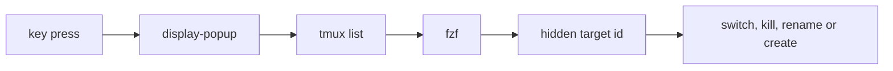

<div align="center">

# tmux-fzf-revamped

<strong>Switch to, kill, rename or create tmux sessions, windows and panes from fzf pickers in a popup.</strong>

English &nbsp;|&nbsp; [日本語](README.ja.md) &nbsp;|&nbsp; [简体中文](README.zh-Hans.md) &nbsp;|&nbsp; [繁體中文（香港）](README.zh-HK.md)

[](https://github.com/tmux-revamped/tmux-fzf-revamped/actions/workflows/tests.yml)
[](LICENSE)
[](CHANGELOG.md)

<p align="center">
  <a href="#what-it-does">What it does</a> &nbsp;|&nbsp;
  <a href="#requirements">Requirements</a> &nbsp;|&nbsp;
  <a href="#installation">Installation</a> &nbsp;|&nbsp;
  <a href="#usage">Usage</a> &nbsp;|&nbsp;
  <a href="#configuration">Configuration</a> &nbsp;|&nbsp;
  <a href="#key-bindings">Key bindings</a> &nbsp;|&nbsp;
  <a href="#how-it-works">How it works</a> &nbsp;|&nbsp;
  <a href="#development">Development</a>
</p>

</div>

**16** actions, **1** bound by default, and **10** tmux commands in the palette.

---

## What it does

Each action opens an fzf list in a tmux popup. Pick an entry and the plugin acts on it: switch to a session, window or pane, kill it, rename it, or create a session that does not exist yet.

| Action | What it does |
|:-------|:-------------|
| palette | runs one of 10 tmux commands: `new-window`, both splits, next, previous and last window, `kill-pane`, `kill-window`, `detach-client`, `choose-tree` |
| session switch | lists sessions with their window count and switches the client |
| window switch | lists every window in every session and selects it |
| pane switch | lists every pane with its running command and selects it |
| session kill | kills the picked session, with no confirmation |
| tree | sessions, windows and panes in one list, then jumps to the pick |
| create | switches to the picked session, or creates and switches to one named after the query when nothing matches |
| URLs | lists the URLs on the visible screen of the current pane and opens the pick with `open` or `xdg-open` |
| cheatsheet | searches the output of `list-keys` |
| process | lists processes from `ps`, asks `no` or `yes`, then sends `TERM` to the pick |
| rename | picks a window, then prompts for its new name |
| multi-kill | marks several sessions with `Tab`, asks `no` or `yes`, then kills them all |
| broadcast | prompts for a line of text, marks several panes, then types the text into each one followed by `Enter` |
| zoxide | lists `zoxide query -l` directories, then attaches or creates a session in the picked one |
| last | switches the client to the previous session, with no picker |
| move | picks a window, then prompts for the session to move it to |

A name created from a query or a directory keeps only the last path component, with `.`, `:` and spaces turned into `_`.

## Requirements

| Requirement | Version or note |
|:------------|:----------------|
| tmux | 3.2 or later for the popup; older tmux opens each picker in a new window instead |
| bash | 3.2 or later, so the macOS `/bin/bash` works |
| [fzf](https://github.com/junegunn/fzf) | on `PATH` |
| [zoxide](https://github.com/ajeetdsouza/zoxide), optional | for the zoxide action |
| Opener, optional | `open` or `xdg-open`, for the URL action |

CI runs the suite on Linux x86_64 and arm64 with GNU and uutils coreutils, and on macOS Apple Silicon and Intel with the system BSD tools, GNU coreutils and uutils coreutils.

## Installation

With [TPM](https://github.com/tmux-plugins/tpm), add the plugin to `~/.tmux.conf` and press `prefix + I`:

```tmux
set -g @plugin 'tmux-revamped/tmux-fzf-revamped'
```

Without TPM, clone the repository and run the entrypoint from `~/.tmux.conf`:

```sh
git clone https://github.com/tmux-revamped/tmux-fzf-revamped ~/.tmux/plugins/tmux-fzf-revamped
```

```tmux
run-shell ~/.tmux/plugins/tmux-fzf-revamped/fzf-revamped.tmux
```

## Usage

`prefix + M-f` opens the command palette. Every other action stays unbound until you give it a key. This example replaces the stock `s` and `w` choosers with the fzf pickers and adds a few more:

```tmux
set -g @fzf_revamped_session_key s
set -g @fzf_revamped_window_key w
set -g @fzf_revamped_pane_key e
set -g @fzf_revamped_tree_key T
set -g @fzf_revamped_create_key C
set -g @fzf_revamped_last_key L
```

In every picker, type to filter, `Enter` to act, and `Esc` to close without acting. With `@fzf_revamped_preview` set to `on`, the switch pickers show the screen of the entry under the cursor below the list.

## Configuration

| Option | Default | Meaning |
|:-------|:--------|:--------|
| `@fzf_revamped_popup_width` | `60%` | popup width |
| `@fzf_revamped_popup_height` | `50%` | popup height |
| `@fzf_revamped_popup_border` | `rounded` | popup border on tmux 3.4 and later: `rounded`, `single`, `double`, `heavy`, `simple`, `padded` or `none`; ignored on older tmux |
| `@fzf_revamped_preview` | unset | `on` or `1` shows a live preview of the pane under the cursor in the switch pickers |
| `@fzf_revamped_mru` | unset | `on` orders the session list by most recent attach |

Every key option in the next section is read once, when the plugin loads.

### Internal state

The plugin manages this option itself. Do not set it.

| Option | Holds |
|:-------|:------|
| `@fzf_revamped_broadcast_text` | the text typed at the broadcast prompt, held until the pane picker reads it and then unset |

## Key bindings

An empty value or `off` leaves an action unbound.

| Option | Default | Action |
|:-------|:--------|:-------|
| `@fzf_revamped_palette_key` | `M-f` | palette |
| `@fzf_revamped_session_key` | unbound | session switch |
| `@fzf_revamped_window_key` | unbound | window switch |
| `@fzf_revamped_pane_key` | unbound | pane switch |
| `@fzf_revamped_kill_key` | unbound | session kill |
| `@fzf_revamped_tree_key` | unbound | tree |
| `@fzf_revamped_create_key` | unbound | create |
| `@fzf_revamped_url_key` | unbound | URLs |
| `@fzf_revamped_cheatsheet_key` | unbound | cheatsheet |
| `@fzf_revamped_process_key` | unbound | process |
| `@fzf_revamped_rename_key` | unbound | rename |
| `@fzf_revamped_multikill_key` | unbound | multi-kill |
| `@fzf_revamped_broadcast_key` | unbound | broadcast |
| `@fzf_revamped_zoxide_key` | unbound | zoxide |
| `@fzf_revamped_last_key` | unbound | last |
| `@fzf_revamped_move_key` | unbound | move |

`M-f` is this plugin's slot in the family key allocation. Keeping every other action unbound means installing the whole family produces no key conflict.

## How it works



The entrypoint [`fzf-revamped.tmux`](fzf-revamped.tmux) checks the tmux version and binds each key to `display-popup -E`, or to `new-window` before tmux 3.2, running [`src/fzf.sh`](src/fzf.sh). Each list line carries the target id as a hidden first column that fzf does not show, so a window named `feature/login` or a session with a space in its name still resolves to the right object. Text typed at the broadcast, rename and move prompts reaches tmux through the quoting `%%%` placeholder, and broadcast types it with `send-keys -l`, so quotes, `$`, `;` and words such as `Enter` arrive as literal text.

## Development

| Command | What it runs |
|:--------|:-------------|
| `make test` | the bats suite under [`test/`](test) |
| `make lint` | shellcheck at warning severity on every shell file and [`family/bin/`](family/bin) |
| `make coverage` | kcov line coverage on Linux, failing below 95% |

Id parsing, mode and signal validation, version checks and session naming live in [`src/lib/fzf/fzf.sh`](src/lib/fzf/fzf.sh) as pure functions. Every tmux call in [`src/fzf.sh`](src/fzf.sh) goes through one wrapper, so the routing is tested without a tmux server or fzf.

## License

[MIT](LICENSE), copyright Gustavo Franco.

<!-- family:begin -->

## The tmux-revamped family

This plugin is one member of the tmux-revamped family. Every member carries the
same contract in [`FAMILY.md`](FAMILY.md), the same tooling under `family/`, and
the same shared library, all held byte-identical by a checksum manifest. They are
built to be installed together: no member claims a key or a tmux option that
another member claims.

A defect found in one member is hunted across all of them before the fix is
called done. That obligation is written into the contract rather than left to
memory, and `family/bin/sweep` is how it is discharged.

| Member | What it does |
|---|---|
| [`tmux-autoreload-revamped`](https://github.com/tmux-revamped/tmux-autoreload-revamped) | Edit your tmux config, save, and watch it reload itself, no key, no command |
| [`tmux-battery-revamped`](https://github.com/tmux-revamped/tmux-battery-revamped) | Battery status for your tmux status bar, without ever blocking the status render |
| [`tmux-bluetooth-revamped`](https://github.com/tmux-revamped/tmux-bluetooth-revamped) | Every connected Bluetooth device and its battery in your tmux status bar, without blocking the render |
| [`tmux-cpu-revamped`](https://github.com/tmux-revamped/tmux-cpu-revamped) | CPU load, temperature, and frequency in your tmux status bar, without ever blocking the render |
| [`tmux-disk-revamped`](https://github.com/tmux-revamped/tmux-disk-revamped) | Disk usage for your tmux status bar, without ever blocking the status render |
| [`tmux-extract-revamped`](https://github.com/tmux-revamped/tmux-extract-revamped) | Pick a URL, path, hash or any other token off the screen with fzf and type it at the cursor, in pure shell |
| [`tmux-fzf-revamped`](https://github.com/tmux-revamped/tmux-fzf-revamped) | **this plugin**, Switch to, kill, rename or create tmux sessions, windows and panes from fzf pickers in a popup |
| [`tmux-git-revamped`](https://github.com/tmux-revamped/tmux-git-revamped) | Show the active pane's git branch, changes and provider counts in the tmux status bar without blocking it |
| [`tmux-gpu-revamped`](https://github.com/tmux-revamped/tmux-gpu-revamped) | GPU load, temperature, clock, power and memory in the tmux status bar, from NVIDIA, AMD, Intel and Apple GPUs |
| [`tmux-kube-revamped`](https://github.com/tmux-revamped/tmux-kube-revamped) | Current Kubernetes context and namespace in the tmux status bar, parsed from kubeconfig without kubectl |
| [`tmux-launcher-revamped`](https://github.com/tmux-revamped/tmux-launcher-revamped) | Launch any TUI app in a popup or a window, scoped to the current pane's directory, with one configurable bindi |
| [`tmux-logging-revamped`](https://github.com/tmux-revamped/tmux-logging-revamped) | Capture any pane to a file: live logging, full scrollback, or a one-shot screenshot |
| [`tmux-music-revamped`](https://github.com/tmux-revamped/tmux-music-revamped) | Now playing in your tmux status bar, without ever blocking the status render |
| [`tmux-network-revamped`](https://github.com/tmux-revamped/tmux-network-revamped) | Network throughput in your tmux status bar, without ever blocking the render |
| [`tmux-pain-control-revamped`](https://github.com/tmux-revamped/tmux-pain-control-revamped) | Standard pane and window management bindings for tmux, version aware, vim friendly, and fully configurable |
| [`tmux-persist-revamped`](https://github.com/tmux-revamped/tmux-persist-revamped) | Save every tmux session, window and pane, auto-save on a timer, and restore it all after a reboot |
| [`tmux-plugin-template`](https://github.com/tmux-revamped/tmux-plugin-template) | A template for building non-blocking tmux status plugins |
| [`tmux-pomodoro-revamped`](https://github.com/tmux-revamped/tmux-pomodoro-revamped) | A Pomodoro timer in the tmux status bar that keeps all of its state in tmux options, with no temp files |
| [`tmux-ram-revamped`](https://github.com/tmux-revamped/tmux-ram-revamped) | RAM, swap and memory pressure in the tmux status bar, sampled in the background so the render never waits |
| [`tmux-reorder-revamped`](https://github.com/tmux-revamped/tmux-reorder-revamped) | Drag a window tab along the tmux status bar with the mouse to move that window |
| [`tmux-scroll-revamped`](https://github.com/tmux-revamped/tmux-scroll-revamped) | Send the mouse wheel to apps that scroll themselves and into tmux copy-mode everywhere else |
| [`tmux-sensible-revamped`](https://github.com/tmux-revamped/tmux-sensible-revamped) | Sensible tmux defaults, gated by tmux version and terminal, that leave the options you set alone |
| [`tmux-tiling-revamped`](https://github.com/tmux-revamped/tmux-tiling-revamped) | BSP tiling window management for tmux. Eight layouts, nineteen operations, zero dependencies |
| [`tmux-time-revamped`](https://github.com/tmux-revamped/tmux-time-revamped) | Local and world clocks for the tmux status bar, colored by time of day, with countdowns and a DST warning |
| [`tmux-weather-revamped`](https://github.com/tmux-revamped/tmux-weather-revamped) | Weather for the tmux status bar from wttr.in, fetched in the background so the status line never waits |

### Checking an installation

With every member on disk, one command reports any conflict between them:

```sh
family/bin/doctor --live
```

It reads each member and the running tmux server, and reports duplicate keys,
duplicate status placeholders, options outside the naming grammar, and any
member whose contract version has fallen behind.

<!-- family:end -->
